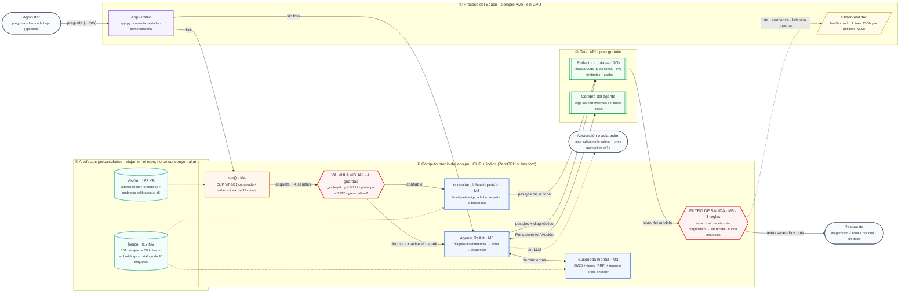

# Una URL que funciona · Entrega M5 (30 %)

**El recomendador de manejo agronómico de M1–M4, desplegado, medido y observable**

**Tópicos Especiales y Aplicaciones en IA · Universidad EAFIT · Módulo 5 — Eficiencia, despliegue y compresión**

**Equipo:** Luciana Hoyos · Sara López · Juan Carlos Citelly · Santiago Manco Maya

---

## La URL

> ### 🌿 <https://huggingface.co/spaces/Manco312/agroai>
>
> Hugging Face Space · SDK Gradio · **ZeroGPU** · público.
> Pestaña **Estado** = health check en vivo. Pestaña **Cómo funciona** = las rutas y el filtro.
>
> Se duerme tras ~48 h sin uso: ábrelo unos minutos antes de presentar.

La carpeta que se sube se genera con `python scripts/preparar_space.py --con-ejemplos`
(40 archivos, 21 MB). Ver [Cómo se despliega](#cómo-se-despliega).

El **reporte final del proyecto** (M1→M5: arquitectura, scorecard, eficiencia, ablaciones,
errores, límites y ética) está en [`REPORTE_FINAL.md`](REPORTE_FINAL.md).

## Qué cambió en M5

M4 terminó con una frase: *"mientras el redactor sea un modelo de 0.5B, **no debe
desplegarse sin un filtro de salida** que bloquee las prescripciones cuando el diagnóstico es
'sano' o cuando la válvula se ha disparado"*. M5 es esa frase cumplida, más lo que hace falta
para que el sistema exista fuera de un notebook.

| | M4 | M5 |
|---|---|---|
| **Dónde vive** | `notebookM4.ipynb`, que ejecuta las celdas de `notebookM3.ipynb` | paquete `agro/` + `app.py`, sin notebooks |
| **Arranque** | lee 50 PDF, trocea y codifica 151 chunks cada vez | índice precalculado: `np.load` |
| **Redactor** | Qwen2.5-0.5B + LoRA en fp16, GPU | **`gpt-oss-120b` vía Groq** sobre las mismas fichas. El modelo propio sigue disponible y es el que miden los scorecards; las variantes comprimidas se midieron y **se rechazaron** (incumplen el contrato) |
| **Planificador** | ReAct con Qwen2.5-1.5B | el mismo motor de Groq elige las herramientas; sin clave, ruta determinista (ablación en §8.2 del reporte) |
| **Seguridad de salida** | ninguna — `img-05` recetó 50–100 g/ha sobre una hoja sana | **filtro de salida** de tres reglas, con pruebas y ablación |
| **Observabilidad** | prints del notebook | health check + una línea JSON por petición + W&B |

## La arquitectura desplegada

Tres cosas que el diagrama quiere dejar claras: **dónde corre cada pieza** —ZeroGPU asigna
la GPU sólo dentro del recuadro ②—, **qué viaja por cada flecha**, y **las dos compuertas
rojas**, que son la tesis del proyecto: una decide si la foto es creíble y la otra decide si
lo que escribió el modelo puede salir.



### Qué cambió frente al borrador del curso

| | |
|---|---|
| **Groq redacta, pero no diagnostica** | El cuello de botella medido desde M3 es la generación, no el conocimiento: el retrieval acierta (hit@3 = 12/12 en fichas externas) y el 0.5B de M1 igual falla. Cambiar sólo esa pieza es lo más barato que ataca el fallo medido. **El diagnóstico lo sigue dando el clasificador propio de M4 y la evidencia el índice de M3**, y la respuesta declara que la redacción es de un modelo externo. Sin clave, el sistema no se cae: vuelve al modelo de M1. |
| **ZeroGPU, no CPU** | La GPU se asigna sólo dentro de `@spaces.GPU`. Fuera de ese recuadro no hay GPU **ni siquiera al arrancar**, y eso obliga a construir los modelos en CPU y moverlos en la primera petición. |
| **El filtro ya no es «sugerido»** | Está implementado, tiene pruebas propias y una ablación que lo mide: sin él, 1 dosis inventada y 1 receta sobre hoja sana; con él, 0 y 0. |
| **El índice no se construye al arrancar** | Los 151 pasajes y sus embeddings viajan precalculados. El arranque es un `np.load`, no leer 50 PDF. |
| **La observabilidad entra al diagrama** | Porque es parte del entregable, no un adorno: una línea JSON por petición, health check y W&B. |

> **Por qué la ruta con foto es *más rápida* que la de texto:** cuando el clasificador está
> seguro, la etiqueta elige la ficha directamente y el sistema **se salta la búsqueda y el
> bucle del agente**. Cuando no lo está, la válvula lo devuelve a la ruta de texto, que ya
> sabía pedir el cultivo o abstenerse.

## Cómo se corre

```bash
cd M5
pip install -r requirements.txt gradio==6.31.0

python scripts/test_filtro.py          # pruebas del filtro de salida (1 s, sin modelos)
python scripts/humo.py                 # prueba de humo de las cuatro rutas
python app.py                          # la app en http://localhost:7860
```

Variables de entorno (todas opcionales; los valores por defecto son los de M1–M4).
La lista completa, comentada y con los valores por defecto, está en
[`.env.example`](.env.example) — cópialo a `.env` para trabajar en local:

| Variable | Qué hace | Por defecto |
|---|---|---|
| `AGRO_BACKEND` | `fp32peft_cpu` · `fp32_cpu` · `bf16_cpu` · `int8_cpu` · `fp16_gpu` · `int4_gpu` · `groq` | `auto` (fp16 si hay CUDA, fp32 si no) |
| `AGRO_RUTA` | `react` · `determinista` | `auto` (react si hay CUDA) |
| `AGRO_FILTRO` | `0` apaga el filtro de salida (sólo para la ablación) | `1` |
| `GROQ_API_KEY` | activa el redactor por API. **Sin ella el sistema no se cae**: usa el modelo de M1 | vacío |
| `AGRO_MAX_TOKENS` | tope de la respuesta cuando redacta Groq. El de M2 (200) estaba dimensionado para un 0.5B y cortaba las respuestas a media frase | `900` |
| `AGRO_MAX_CTX` | caracteres de contexto que entran al prompt | `3200` |
| `AGRO_K_FINAL` | pasajes que llegan al prompt | `3` |
| `AGRO_PLANIFICADOR` | `groq` · `local` — quién elige las herramientas del bucle ReAct | `auto` |
| `AGRO_UMBRAL_PROTO` | mueve el punto de operación de la válvula sin tocar el artefacto calibrado | el calibrado en M4 |
| `AGRO_WANDB` + `WANDB_API_KEY` | observabilidad en W&B | apagado |

### Volver a construir el índice

El índice viaja construido en `artefactos/`. Para rehacerlo desde los 50 PDF de M4:

```bash
pip install pypdf==6.16.2 reportlab chromadb
python scripts/construir_indice.py
```

El script **verifica antes de escribir** y aborta si algo cambió:

| Comprobación | Resultado |
|---|---|
| 50 documentos → **151 chunks** (igual que M3 §7) | ✅ |
| 6 consultas de retrieval con salida registrada en `notebookM3.ipynb` (densa, BM25, híbrida, reranker) | ✅ **6/6 idénticas** |
| ninguna de las 50 fichas contiene una dosis numérica | ✅ **0** |

La tercera no es burocracia: es la **premisa de la regla 3 del filtro de salida**. Como
ninguna ficha trae dosis, toda cifra de dosis en una respuesta la inventó el modelo. Si
mañana alguien añade una ficha con dosis, el script falla y obliga a revisar el filtro.

Las dos primeras comprobaciones son la prueba de que el sistema desplegado **recupera lo
mismo** que el que se evaluó en M3 y M4, aunque el motor denso ya no sea Chroma sino un
producto punto sobre los embeddings precalculados (las consultas de regresión son, de hecho,
salidas de Chroma registradas en el notebook de M3).

### Reproducir las mediciones

```bash
# las técnicas de eficiencia en el entorno de despliegue (2 vCPU simulados)
python scripts/bench_eficiencia.py --variantes fp32peft_cpu,fp32_cpu,bf16_cpu,int8_cpu \
       --eval-set eval_set_m3.json --etiqueta cpu --hilos 2

# la cuantización del lab S15 (NF4) frente al sistema de M4 (fp16), en GPU
python scripts/bench_eficiencia.py --variantes fp16_gpu,int4_gpu \
       --eval-set eval_set_m3.json --etiqueta gpu --base fp16_gpu

# el scorecard de M5 al lado de los de M3 y M4
python scripts/scorecard_m5.py

# ablación 1 — el filtro de salida (no genera: reusa las respuestas ya medidas)
python scripts/ablacion_filtro.py resultados/eficiencia_cpu_crudo.json

# ablación 2 — el planificador ReAct frente a la ruta determinista
python scripts/bench_ablacion.py --backend fp16_gpu

# el plan B de la demo: las respuestas ya corridas, listas para proyectar
python scripts/plan_b.py

# subir todo a W&B (offline si no hay WANDB_API_KEY)
python scripts/wandb_publicar.py
```

El banco va en **dos procesos**: `bench_eficiencia.py` genera y `puntuar.py` puntúa (lo
lanza solo al terminar). No es capricho: el juez de M2 es un Qwen2.5-1.5B y no cabe en
memoria junto a CLIP y el cross-encoder. La ventaja de haberlo separado es que volver a
puntuar no obliga a volver a generar:

```bash
python scripts/puntuar.py resultados/eficiencia_cpu_crudo.json
```

## Qué hay en esta carpeta

| Archivo | Qué es |
|---|---|
| [`app.py`](app.py) | la app de Gradio: consulta, estado (health check) y cómo funciona |
| [`agro/`](agro/) | el sistema M1–M4 como paquete: `vision`, `indice`, `herramientas`, `planificador`, `sistema`, `juez`, `observabilidad` |
| [`artefactos/indice/`](artefactos/indice/) | 151 chunks, sus embeddings, el catálogo y el `manifiesto.json` con hashes y versiones |
| [`artefactos/vision/`](artefactos/vision/) | la cabeza lineal, los prototipos y los umbrales calibrados de M4, **sin tocar** |
| [`scripts/`](scripts/) | construir el índice · prueba de humo · pruebas del filtro · el banco de eficiencia y su contrato · las dos ablaciones · el scorecard · el plan B · armar el Space · publicar en W&B |
| [`resultados/`](resultados/) | los `.json`, `.csv` y `.md` de cada corrida, y [`plan_b_casos.md`](resultados/plan_b_casos.md) para la demo |
| [`REPORTE_FINAL.md`](REPORTE_FINAL.md) | el reporte final del proyecto (M1→M5) |
| [`declaracion-uso-ia.md`](declaracion-uso-ia.md) | declaración de uso de IA |
| [`requirements.txt`](requirements.txt) | versiones fijadas |

Los notebooks de M1–M4 y sus datos están en [`../modulos_anteriores/`](../modulos_anteriores/),
sin modificar.

## Cómo se despliega

```bash
python scripts/preparar_space.py --con-ejemplos      # arma build_space/ (21 MB)
cd build_space
git init && git lfs install
git remote add origin https://huggingface.co/spaces/<usuario>/<space>
git add -A && git commit -m "M5: sistema completo" && git push -u origin main
```

El Space se crea en huggingface.co/new-space con **SDK Gradio** y hardware **ZeroGPU**. Los
secretos (`WANDB_API_KEY`, `AGRO_WANDB=1`, `GROQ_API_KEY`) van en *Settings → Variables and
secrets*, nunca en el código. Sin ninguno de ellos el Space funciona igual: usa el modelo
propio del curso y escribe el log localmente.

### Lo que ZeroGPU cambia respecto de un Space de CPU

ZeroGPU no da una GPU permanente: la asigna sólo mientras corre una función decorada con
`@spaces.GPU`. Eso impone tres reglas, y las tres están resueltas en el código:

| Regla de ZeroGPU | Dónde se resuelve |
|---|---|
| La GPU **no existe al arrancar**. Los modelos se cargan y se mandan a `cuda` igual; la reserva real se difiere. | `calentar()` en `app.py`; `fijar_semillas()` tolera que no haya GPU |
| Sólo lo que está dentro de `@spaces.GPU` ve la GPU, y corre **en otro proceso**: lo que se mute ahí dentro no vuelve. | `_responder_en_gpu()` sólo responde; el logging, los contadores y el health check se quedan fuera. Si `observabilidad.registrar()` viviera dentro, la pestaña de Estado diría siempre "0 peticiones" |
| `torch` lo pone la imagen de ZeroGPU. | `requirements.txt` **no fija torch**, y el health check reporta la versión que acabó corriendo |

El tope por petición es de 120 s (`AGRO_GPU_DURACION`). La ruta más cara —ReAct con hasta 4
pasos del planificador de 1.5B más la redacción— va muy por debajo en una GPU.

Con ZeroGPU el backend desplegado es **`fp16_gpu`**, que es el sistema tal cual lo entregó
M4 y la variante que mejor puntúa de todas las medidas. Si la GPU no estuviera disponible,
el redactor **degrada solo** a `fp32_cpu` y lo dice en el health check en vez de caerse.
